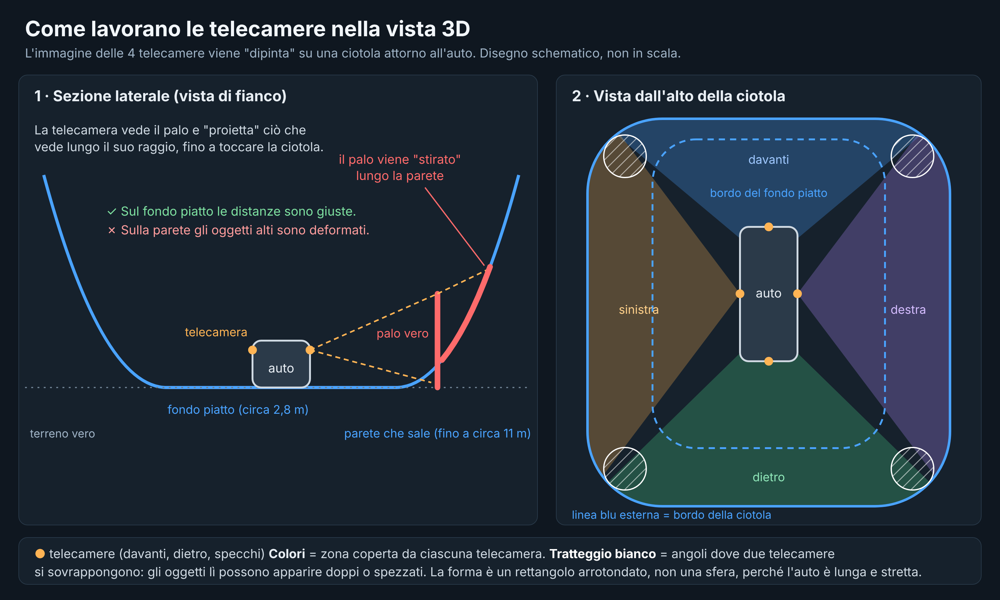
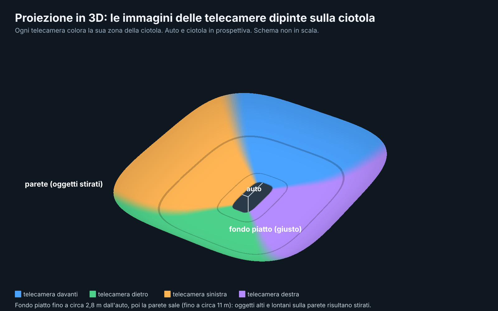

🇮🇹 Italiano | [🇬🇧 English](PROJECTION-3D.en.md)

# Come funziona la vista 3D (la proiezione delle telecamere)

Questa pagina spiega, in modo semplice, come Rivela 360 costruisce le viste 360° e 3D a partire dalle 4 telecamere dell'auto, e quali sono i limiti che ne derivano. I disegni sono **schemi, non in scala e non schermate dell'app**.

## L'idea: la ciotola
Le telecamere non vedono la profondità: ognuna produce solo un'immagine piatta. Per ricomporle, l'app "dipinge" le immagini su una superficie attorno all'auto a forma di **ciotola**:

- **Fondo piatto** vicino all'auto, fino a circa **2,8 m** dalla carrozzeria. Qui l'immagine è proiettata a terra e le distanze e le linee guida sono corrette.
- **Parete che sale** oltre quel limite, fino a circa **11 m**. Serve a mostrare l'ambiente circostante (edifici, auto, alberi) invece di tagliarlo.
- Il profilo è un **rettangolo con gli angoli arrotondati**, non un cerchio e non una sfera: l'auto è lunga e stretta e una forma tonda sposterebbe troppo lontano il terreno sui fianchi, dove si parcheggia. L'inizio e la ripidezza della parete sono regolabili nelle impostazioni della vista 3D.
- Ogni telecamera colora la **sua** zona (davanti, dietro, sinistra, destra). Dove due zone si incontrano, agli angoli, le immagini si sfumano l'una nell'altra.

## Distorsioni inevitabili
- **Sul fondo piatto:** pochissime.
- **Oggetti alti** (muri, auto parcheggiate, persone): la telecamera li vede, ma non sa a che distanza sono. L'immagine viene proiettata lungo il raggio visivo fino a toccare la ciotola, quindi l'oggetto risulta **stirato lungo la parete**.
- **Giunzioni tra due telecamere:** gli oggetti negli angoli possono comparire **doppi o spezzati**, perché le due telecamere li vedono da punti di vista diversi.

Eliminarle del tutto richiederebbe di conoscere la profondità degli oggetti (con LiDAR o con una coppia stereo), che l'auto non ha. Vale per ogni sistema 360 basato su sole telecamere.

## I limiti delle telecamere
- Le 4 telecamere sono **basse** sulla carrozzeria e guardano molto in orizzontale (angolo di circa 185°). Vedono bene il terreno vicino, con molti pixel per metro.
- Il terreno **lontano** lo vedono di taglio: oltre circa 3-5 m l'immagine è sfocata e stirata, qualunque sia la vista.
- Il terreno **sotto l'auto** non si vede: l'app lo copre con il modello.

## Quale vista usare
- **Vista dall'alto (360°):** la più adatta per **posizionarsi e parcheggiare**: le distanze sono più facili da leggere.
- **Telecamera singola:** per il dettaglio su un lato o sul paraurti.
- **Vista 3D:** un aiuto per **orientarsi** e controllare un angolo, non per misurare le distanze a occhio. Con la visuale bassa mostra soprattutto terreno lontano (il punto debole delle camere) e l'auto scura può coprire il terreno vicino alle ruote. In 3D restano comunque visibili linee guida e barre dei sensori.

> L'app è solo un ausilio: guarda sempre anche gli specchietti e direttamente fuori. Vedi le [Avvertenze](DISCLAIMER.md).
