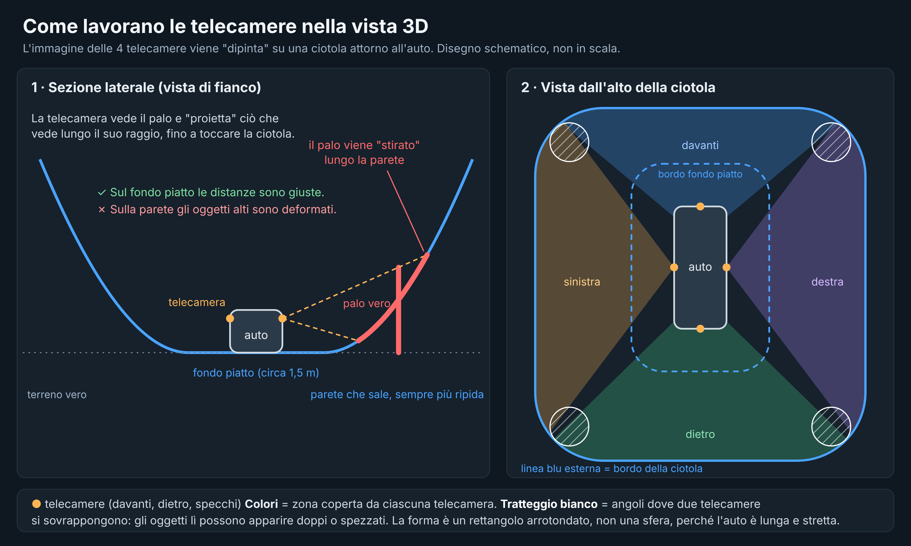
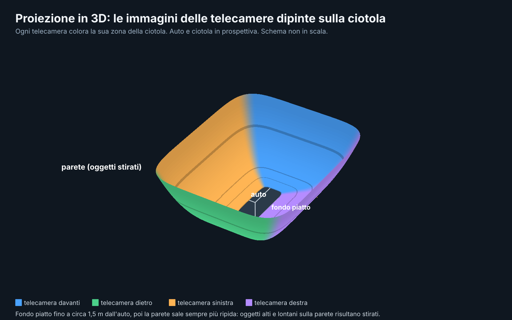

🇬🇧 English | [🇮🇹 Italiano](PROIEZIONE-3D.md)

# How the 3D view works (camera projection)

This page explains, in simple terms, how Rivela 360 builds the 360° and 3D views from the car's 4 cameras, and the limits that follow. The drawings are **diagrams, not to scale and not screenshots of the app**.

## The idea: the bowl
The cameras don't see depth: each one produces only a flat image. To put them together, the app "paints" the images onto a **bowl**-shaped surface around the car:

- **Flat floor** near the car, up to about **1.5 m** from the bodywork. Here the image is projected onto the ground, so distances and guide lines are correct.
- **Rising wall** beyond that, **getting steeper** with distance, up to about **11 m** from the car. It shows the surroundings (buildings, cars, trees) instead of cutting them off.
- The outline is a **rectangle with rounded corners**, not a circle or a sphere: the car is long and narrow, and a round shape would push the ground at the sides, where you park, too far away. Where the wall starts and how steep it is are fixed values: they cannot be adjusted in the settings.
- Each camera paints **its own** zone (front, rear, left, right). Where two zones meet, at the corners, the images blend into each other.

## Unavoidable distortions
- **On the flat floor:** very little.
- **Tall objects** (walls, parked cars, people): the camera sees them but doesn't know how far away they are. The image is projected along the line of sight until it hits the bowl, so the object ends up **stretched along the wall**.
- **Seams between two cameras:** objects in the corners may appear **doubled or broken**, because the two cameras see them from different viewpoints.

Eliminating them entirely would require knowing the depth of objects (with LiDAR or a stereo pair), which the car doesn't have. This applies to every camera-only 360 system.

## Camera limits
- The 4 cameras are mounted **low** on the bodywork and look mostly sideways (about 185° field of view). They see the nearby ground well, with many pixels per metre.
- **Distant** ground is seen at a grazing angle: beyond about 3-5 m the image is blurred and stretched, whatever the view.
- The ground **under the car** is not visible: the app covers it with the model.

## Which view to use
- **Top view (360°):** the best for **positioning and parking**: distances are easier to read.
- **Single camera:** for detail on a side or the bumper.
- **3D view:** an aid for **getting your bearings** and checking a corner, not for judging distances by eye. With a low viewpoint it mostly shows distant ground (the cameras' weak spot), and a dark car can hide the ground near the wheels. Guide lines and sensor bars stay visible in 3D.

> The app is only an aid: always also check the mirrors and look directly outside. See the [Warnings](DISCLAIMER.en.md).
