🇬🇧 English | [🇮🇹 Italiano](README.md)

# Rivela 360

 Freeware: if it is useful to you, you can support the project with a free, optional donation.

**An alternative 360° view for the MG4 Electric.** An independent, free project that replaces the stock 360° view with a clearer one, a 3D model of the car and many extra features.

> [!WARNING]
> **Beta version.** Rivela 360 is a hobby project still being tested, used so far on a few cars. It may contain some bugs or behave unexpectedly, especially after an update. The stock 360 can be restored at any time from the settings.

> [!IMPORTANT]
> **It is a driving aid, not a replacement.** Images, lines and distances help a lot, but they can be inaccurate or late: always check the mirrors and look outside the window too. Responsibility for the manoeuvre stays with the driver.
>
> The app takes the place of a stock feature and uses system permissions: installation and use are at your own risk and may affect the warranty. Do your first test stationary, in P. The details are in the [**Warnings and liability**](DISCLAIMER.en.md), which you accept by installing it.

> **Personal, unofficial project, not affiliated with MG Motor or SAIC.**
>
> 🔬 Tested mainly on an **MG4 Electric Luxury MY23, FICM head unit, firmware SWI68 R67, Android 9**.
>
> | Firmware | Status |
> |---|---|
> | **SWI68 R67** | ✅ **Tested** |
> | **SWI133** | ✅ **Works** (tried by a tester). Same Android 9 base, same stock 360 app, same system signature |
> | Others | ❓ Unknown |

## What it does
- **360° top view** built from the 4 cameras, with the car drawn in the middle in the 8 MG4 colours (black or body-coloured roof).
- **3D view** with a model of the car: turn it with one finger; it has lights, indicators and wheels that steer. Three wheel choices: X-Power, Luxury/Trophy 18″ and Luxury MY22 17″.
- **Dynamic guide lines** that follow the steering wheel, in two styles (Classic and Modern), with marks at 1, 2 and 3 m.
- **Parking sensors** with the distance in cm, **automatic zoom** on the obstacle and **cross-traffic** warning in reverse. In 3D they become coloured curtains.
- **Wheel view**: four straightened windows next to the wheels, with a red line on the edge of the car, to get close to kerbs without touching tyres and rims.
- **Car wash mode**: two blue bands show where the front wheels will go.
- **Original or Panoramic camera view**, chosen per camera: Panoramic has straight lines and no black corners.
- **Automatic opening** in reverse and with the indicators, with adjustable opening and closing speeds.
- **Safety net**: if the image does not arrive within 2.5 seconds in reverse, the stock 360 opens.
- **Photos, videos and automatic recording of manoeuvres**, also to a USB stick.
- **Animated explanations** in the settings ("i" button) and **over-the-air updates** from this page.
- **Works with MG4-360-Camera-App** by jamakr4: when Rivela opens the cameras it asks the other app to release them and hands them back when it closes.
- Languages: English, Italian, German, French, Spanish and Czech.

## How to use it
A tour of the app, in the order you meet it in the car. The pictures are real screenshots from the author's car, with version 2.70 beta 1.

### In reverse
When you select reverse the app opens by itself. On the left there is the **top view**, rebuilt from the four cameras with the car drawn in the middle; on the right the **rear camera** image.

As you turn the steering wheel, the **lines** move and show where the car will go. The marks show 1, 2 and 3 metres from the bumper.

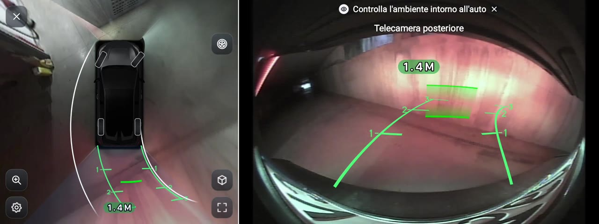

Near the bumper the **sensor bars** appear, with the obstacle distance in centimetres: green, then yellow, then red. When an obstacle is close, the top view **zooms in by itself** on that spot ("Automatic zoom on the obstacle").

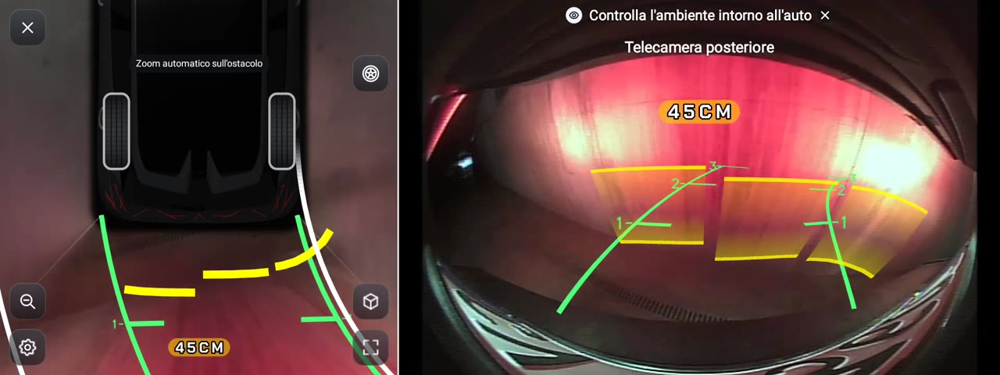

### Changing view
- **Camera:** tap the area around the car you want to see: front, rear or one of the sides.
- **Wide view:** the button at the bottom right shows more space around the car.
- **Lens:** the lens button zooms in on the area you are interested in.

### 3D view
The **cube** button opens the 3D view: you see the car from outside and turn it with one finger to look at it from every side. Use two fingers to get closer; very close up, the car becomes transparent and you can see what is underneath.

The model shows lights, indicators and wheels that steer. The sensors become **coloured curtains**, green, yellow or red depending on the distance to the obstacle.

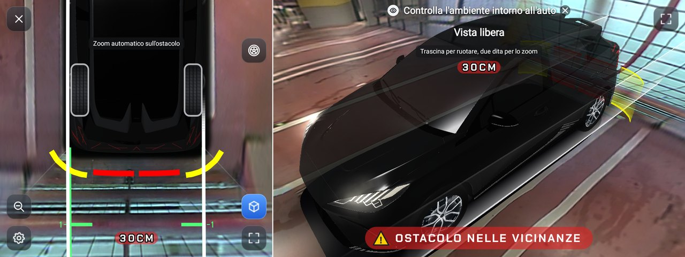

In the settings you choose the car colour and the wheels, and the model changes straight away:

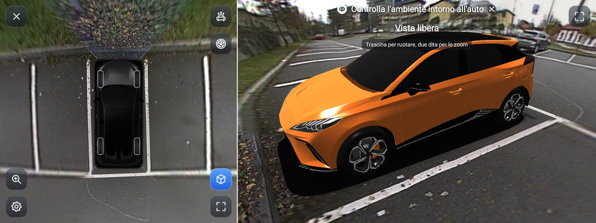

### Wheel view
The **rim** button opens the wheel view: straightened images with a **red line** along the edge of the car. It helps you get close to the kerb without touching tyres and rims. Each window closes with its own X; one tap **enlarges** it, another makes it small again.

The view can also open **by itself** at low speed, when you turn the steering wheel almost to full lock: handy when parallel parking.

**Parallel parking:** as you slot into the space, the windows show the kerb next to each wheel and the red line tells you how much room is left. One tap enlarges the wheel you are interested in.

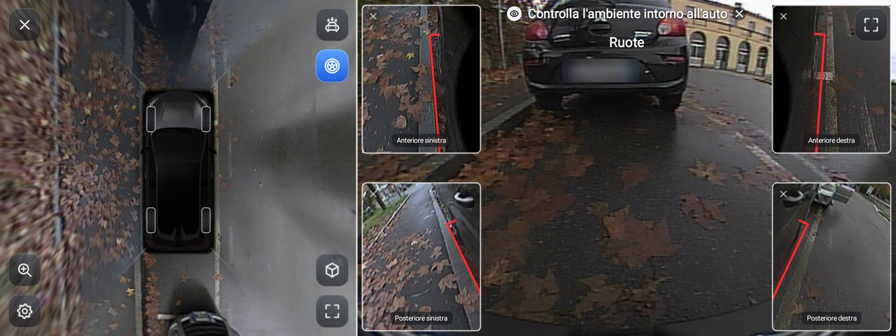

**Video (1 min 29 s):** parallel parking from start to finish. Click the picture to watch it on YouTube.

[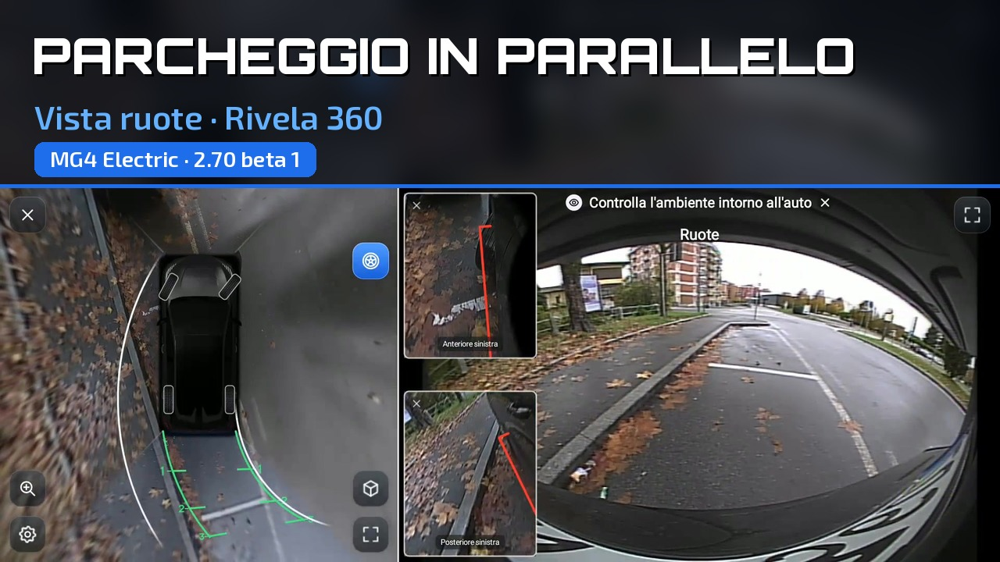](https://youtu.be/g0i7RoX5Mp8)

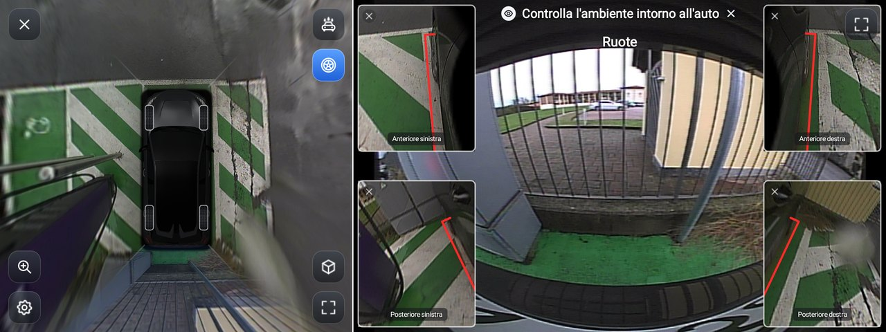

### Car wash
To drive into a car wash tunnel there is the **car wash mode**: two blue bands show where the front wheels will go and help you line up with the rails.

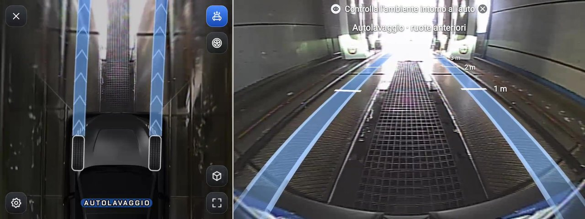

**Video (39 s):** driving into the car wash tunnel with the blue bands. Click the picture to watch it on YouTube.

[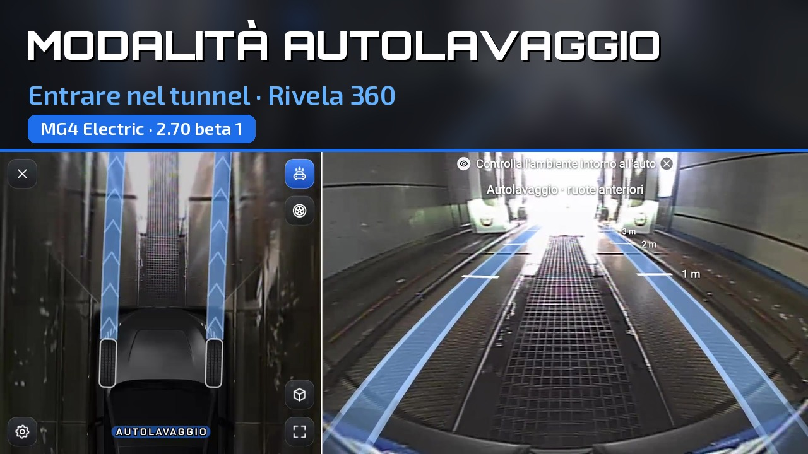](https://youtu.be/NuJO1H80DHk)

### Driving forward
With the **indicator** on, at low speed, the app shows the camera on that side. You can also open it by hand from its icon, at any speed: with the front camera you can see right in front of the bonnet.

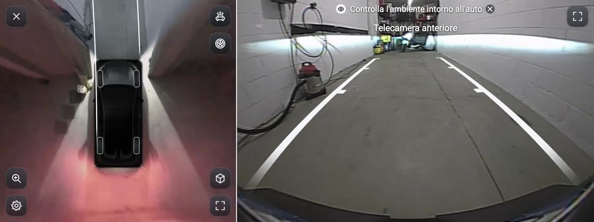

### Settings
They open from the **gear** at the bottom left and are split into eight tabs. The most useful things:

- **Opening and closing:** what opens with reverse and the indicators, **Rivela 360 or the stock 360**. From here you can go back to the stock 360 at any time. If you open the app by hand, it can stay open until you close it.
- **Reverse** and **Drive:** guide lines, line style (Classic or Modern) and automatic zoom on the obstacle, with the distance it starts at.
- **360° view** and **3D view:** car and roof colour, wheels, lights and brightness of the 3D model.
- **Tests and advanced:** stationary tests (simulated reverse, sensors, cross traffic) and the view of each camera, **Original** or **Panoramic**.
- **Updates:** the app updates over the air from this GitHub page; here you can also read again what is new in each version.

If you are unsure about an option, tap the **"i"** next to it: a short animation explains what it does.

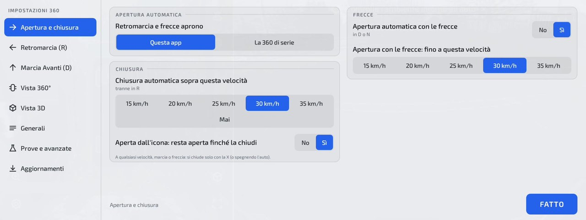
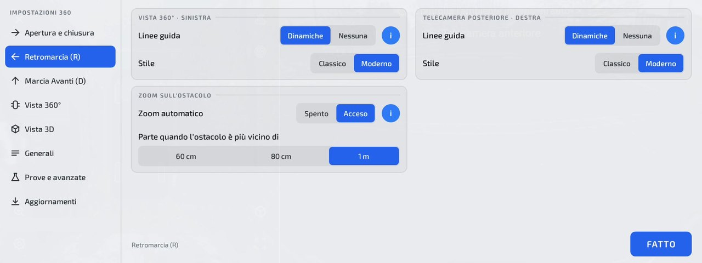
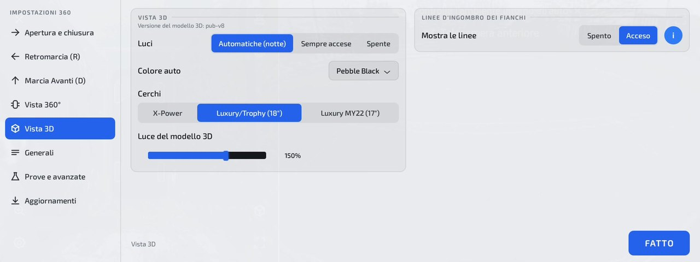
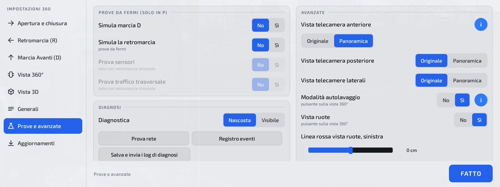

## Installing
The step-by-step guide, including how to go back to the stock 360, is in [**GUIDE.en.md**](GUIDE.en.md). In short:
1. Download the APK of the **recommended version** from the [**Releases**](https://github.com/andneg7/rivela360-mg4/releases/latest) page (*Assets* section). Newer betas are in the [`releases/`](releases/) folder.
2. Copy it to a USB stick, open it from the car's file manager and tap *Install*.
3. On first launch, stationary in P, read and accept the warnings. Do a first test while stationary before using it to manoeuvre.

> [!NOTE]
> **After switching the car on, wait for the infotainment to finish booting.** Rivela 360 is only available once the boot is complete. In the meantime, when reversing, the stock fast rear camera (fast RVC) is there: it is independent of Android and works even while it boots.

## Going back to the stock 360
Before uninstalling the app or doing an MG firmware update: *Settings › Reversing and turn signals open › The stock 360*. Full details are in the [guide](GUIDE.en.md#going-back-to-the-stock-360).

## How the 3D view works
The projection of the cameras onto the "bowl", the distortions and the limits of the 4 cameras are explained in [**PROJECTION-3D.en.md**](PROJECTION-3D.en.md).

## Technical notes
How the cameras, firmware, stock 360° app, fast rear-view camera and car data work, with what we verified in the car: [**TECHNICAL-NOTES.en.md**](TECHNICAL-NOTES.en.md).

## Beta testing
Want to help test it? The instructions, with the list of tests and the form for your result, are in [**BETATEST.en.md**](BETATEST.en.md).

## Reporting a problem
Settings › *Tests and advanced* › Diagnostics › *Save and send diagnostic logs*: the file is saved to `Download/MG4-360-log`. Open a [GitHub Issue](https://github.com/andneg7/rivela360-mg4/issues/new) and attach the file, stating the car model and year, firmware, app version and what you were doing. Issues are public: no personal data.

## Updates
The app checks for updates from this repository (Settings › Updates). The list of versions is in [`releases/`](releases/). There are two channels: **Stable** (default) and **Beta**, which gets test builds first. After each update the app shows a **What's new** window once, with what has changed (you can read it again in Settings › Updates).

## Freeware and donations
**Rivela 360 is freeware**: free to download and use, with no ads, no paid features and no sign-up. It is not open source (the code is not published).
If it is useful to you and you want to support the work, you can make a **free, optional donation** with PayPal. It entitles you to nothing extra: no extra features, no guaranteed support, no priority.

## License and credits
Full text of the terms: [**LICENSE**](LICENSE).

- **Rivela 360** is free for personal, non-commercial use. The source code is not published. Selling it or distributing it for a fee is not allowed.
- **3D car model**: "[2025 MG MG4 (GLB)(mgmotor.com.mx)](https://sketchfab.com/3d-models/2025-mg-mg4-glbmgmotorcommx-ee2e3b0e1a7b481cb2c08e6fc6d2ed9e)" by **MattDoesBlender** (Sketchfab), licensed [**CC BY-NC-SA 4.0**](https://creativecommons.org/licenses/by-nc-sa/4.0/). The `car3d-pub-*.bin` files are **modified** versions: simplified (from about 1.1 million to about 430,000–550,000 triangles), split into groups and reordered for the graphics chip, with the bodywork recoloured, the interior removed, and manufacturer logos and number plates removed. The X-Power wheels are the model's own, with coloured brake calipers; for Luxury/Trophy 18″ and Luxury MY22 17″ the rim is an image applied to the wheel disc, with a logo-free centre cap and tyres in proportion. The top-view car images used by the app are also rendered from this model. They are distributed under the same license: non-commercial use only, with this attribution.
- **Wheel view**: idea from [MG4-360-Camera-App](https://github.com/jamakr4/MG4-360-Camera-App) by **jamakr4**, with his permission. The code is our own. The camera hand-over between the two apps (Release/Resume) was also developed with him.
- **Fonts**: Exo 2, Chakra Petch and Orbitron, under the SIL Open Font License 1.1.
- The app neither contains nor uses images or text from the stock app: the top-view car, icons and warnings are our own. It only reads from the car the data it needs to work (cameras, gear, steering, sensors, calibration).
- MG, MG4 and SAIC are trademarks of their respective owners, mentioned only to indicate compatibility.

## Use of artificial intelligence
Parts of Rivela 360's code, documentation and graphics were developed with AI assistance (**Claude** by Anthropic). Design decisions, in-car testing and responsibility for the project remain with the developer.
