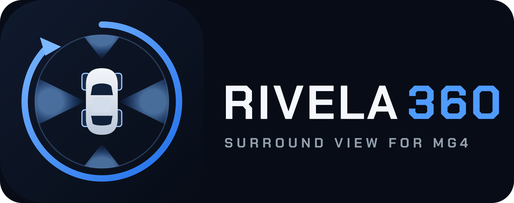
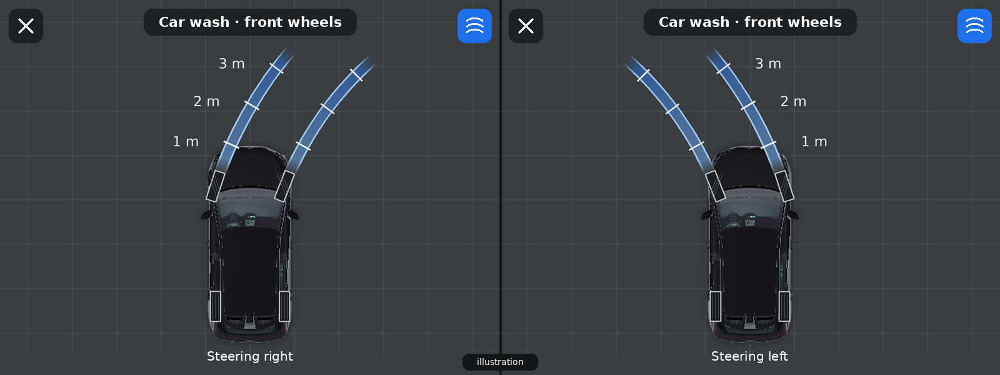
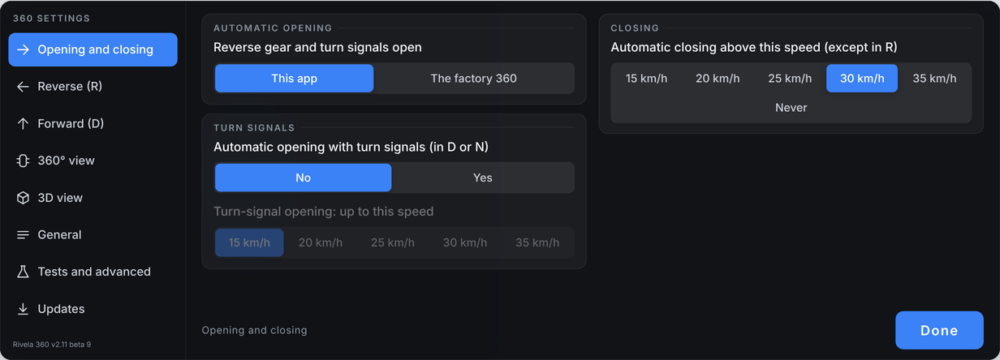
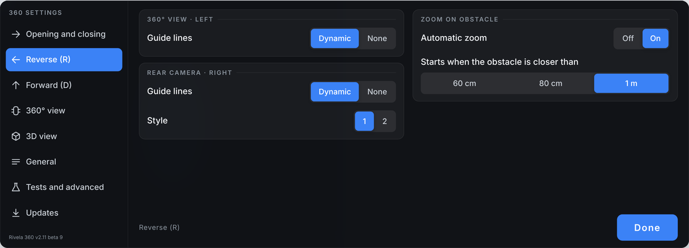
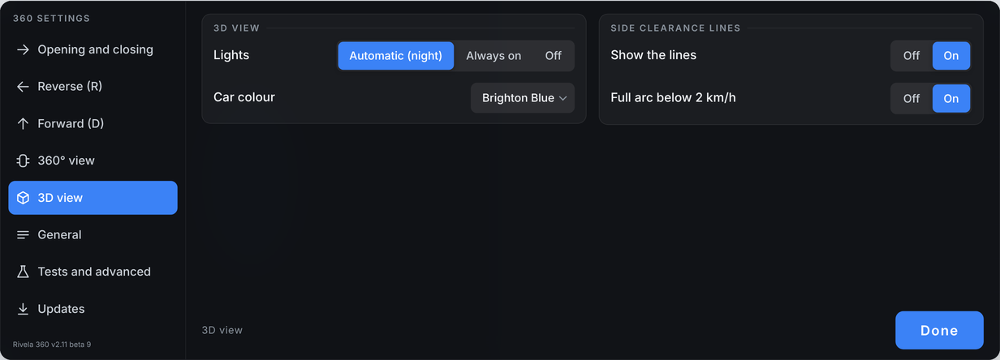

🇬🇧 English | [🇮🇹 Italiano](README.md)

# Rivela 360

 Freeware: if it is useful to you, you can support the project with a free, optional donation.

**An alternative 360° view for the MG4 Electric.** An independent, free project that replaces the stock 360° camera interface with a clearer view, a 3D model of the car and many extra features.

> [!WARNING]
> ## 🧪 EXPERIMENTAL BETA VERSIONS: USE WITH CAUTION
> **All Rivela 360 versions are, for now, experimental betas.** It is a hobby project, tried so far on a single car. They may contain bugs, behave unexpectedly or stop working after an update. **Use them with caution**: never rely on this app as your only way to see around the car. The stock 360° can be restored at any time from the app settings.

> [!CAUTION]
> ## ⚠️ A DRIVING AID: IT DOES NOT REPLACE YOUR ATTENTION
> - **Rivela 360 is only an aid.** Images, guide lines, distances, colours, sensor bars and warnings can be **inaccurate, late, missing or wrong**.
> - **The driver is always solely responsible for the manoeuvre.** **Always** also check the mirrors and **look directly outside** the window, and comply with traffic law.
> - **Don't rely on the screen alone** for distances, obstacles, people, animals or children near the car.
> - **It replaces a stock application of the car** and uses system permissions: it can cause malfunctions, including of the original camera, and may void the warranty. **Installation and use are at your sole risk.**
> - **Always try it stationary**, in P, in a safe place, before using it to manoeuvre.
> - Before installing it, read the [**Warnings and liability**](DISCLAIMER.en.md): by installing it you accept them.

> **Personal, unofficial project, not affiliated with MG Motor or SAIC.**
>
> 🔬 **Test version.** It has been tried on a single configuration only: **MG4 Electric Luxury MY23, FICM head unit, firmware SWI68 R67, Android 9**. I don't know how it behaves on other versions.
>
> | Firmware | Status |
> |---|---|
> | **SWI68 R67** | ✅ **Tested** |
> | **SWI133** | ⚠️ **Not tested.** A firmware analysis shows no relevant differences (same Android 9 base, same stock 360 app, same system signature), but only a test on the car can confirm it |
> | Others | ❓ Unknown |

## What it does
- **360° view** built from the 4 cameras, shown next to a single-camera view or the **3D view** with the car model.
- **Realistic top-view car**, rendered from the 3D model, in the 8 MG4 colours, with a black or body-coloured roof (also in the 3D view).
- **Dynamic guide lines** that follow the steering, **side clearance lines** with the full arc when stationary, and **sensor bars** also in 3D.
- **Parking sensors** with distance in cm and automatic zoom on the obstacle, plus a **cross-traffic** warning when reversing.
- **Car wash mode**: light-blue bands on the front wheels to line up with the track of car wash tunnels, also in 3D with the car semi-transparent.
- **Automatic opening** when reversing and with the turn signals, with adjustable opening and closing speed.
- **Safety net**: if the app doesn't show the image within 2.5 seconds when reversing, the stock 360 opens.
- **Photos, videos and automatic recording of manoeuvres**, also to a USB stick.
- Languages: English, Italian, German, French and Spanish.

## What it looks like
> The reversing and 3D view images are **mockups** (a simulated screen and a render of the 3D model); the settings ones are faithful recreations of the app's settings screens. None is a photo of the car. In the car the look may differ in some details.

**Reversing:** 360° view on the left, rear camera on the right, with guide lines, sensor bars and distance in cm.

**3D view** with the car model:

**Car wash mode** (front camera): the two strips the front wheels will follow, with marks at 1, 2 and 3 m. *Illustration, not a real screenshot.*

**Settings** (recreations of the app's screens, designed for touch):

> The app's screens appear in the language of the car (English, Italian, German, French or Spanish).

## Installing
The step-by-step guide, including how to go back to the stock 360, is in [**GUIDE.en.md**](GUIDE.en.md). In short:
1. Download the latest APK from the [`releases/`](releases/) folder.
2. Copy it to a USB stick, open it from the car's file manager and tap *Install*.
3. On first launch, stationary in P, read and accept the warnings. **Always try it while stationary before using it to manoeuvre: it is only an aid, responsibility for the manoeuvre stays with you.**

> [!NOTE]
> **After switching the car on, wait for the infotainment to finish booting.** Rivela 360 is only available once the boot is complete. In the meantime, when reversing, the stock fast rear camera (fast RVC) is there: it is independent of Android and works even while it boots.

## Going back to the stock 360
Before uninstalling the app or doing an MG firmware update: *Settings › Reversing and turn signals open › The stock 360*. Full details are in the [guide](GUIDE.en.md#going-back-to-the-stock-360).

## How the 3D view works
The projection of the cameras onto the "bowl", the distortions and the limits of the 4 cameras are explained in [**PROJECTION-3D.en.md**](PROJECTION-3D.en.md).

## Technical notes
How the cameras, firmware, stock 360° app, fast rear-view camera and car data work, with what we verified in the car: [**TECHNICAL-NOTES.en.md**](TECHNICAL-NOTES.en.md).

## Beta testing
Want to help test it? The instructions, with the list of tests and the form for your result, are in [**BETATEST.en.md**](BETATEST.en.md).

## Reporting a problem
Settings › *Tests and advanced* › Diagnostics › *Save and send diagnostic logs*: the file is saved to `Download/MG4-360-log`. Open a [GitHub Issue](https://github.com/andneg7/rivela360-mg4/issues/new) and attach the file, stating the car model and year, firmware, app version and what you were doing. Issues are public: no personal data.

## Updates
The app checks for updates from this repository (Settings › Updates). The list of versions is in [`releases/`](releases/). There are two channels: **Stable** (default) and **Beta**, which gets test builds first.

## Freeware and donations
**Rivela 360 is freeware**: free to download and use, with no ads, no paid features and no sign-up. It is not open source (the code is not published).
If it is useful to you and you want to support the work, you can make a **free, optional donation** with PayPal. It entitles you to nothing extra: no extra features, no guaranteed support, no priority.

## License and credits
Full text of the terms: [**LICENSE**](LICENSE).

- **Rivela 360** is free for personal, non-commercial use. The source code is not published. Selling it or distributing it for a fee is not allowed.
- **3D car model**: "[2025 MG MG4 (GLB)(mgmotor.com.mx)](https://sketchfab.com/3d-models/2025-mg-mg4-glbmgmotorcommx-ee2e3b0e1a7b481cb2c08e6fc6d2ed9e)" by **MattDoesBlender** (Sketchfab), licensed [**CC BY-NC-SA 4.0**](https://creativecommons.org/licenses/by-nc-sa/4.0/). The `car3d-pub-v4.bin` file is a **modified** version: simplified (from about 1.1 million to about 550,000 triangles), split into groups and reordered for the graphics chip, with the bodywork recoloured black, interior and brake calipers removed, wheels replaced by a custom design, and manufacturer logos and number plates removed. The top-view car images used by the app are also rendered from this model. They are distributed under the same license: non-commercial use only, with this attribution.
- **Fonts**: Exo 2, Chakra Petch and Orbitron, under the SIL Open Font License 1.1.
- The app neither contains nor uses images or text from the stock app: the top-view car, icons and warnings are our own. It only reads from the car the data it needs to work (cameras, gear, steering, sensors, calibration).
- MG, MG4 and SAIC are trademarks of their respective owners, mentioned only to indicate compatibility.

## Use of artificial intelligence
Parts of Rivela 360's code, documentation and graphics were developed with AI assistance (**Claude** by Anthropic). Design decisions, in-car testing and responsibility for the project remain with the developer.
