[🇬🇧 English](README.md) | 🇮🇹 Italiano

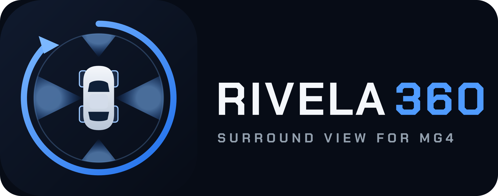

# Rivela 360

  Rivela 360 è gratuita e la faccio da solo, nel tempo libero. Se ti ha evitato un graffio, offrimi un caffè ☕

**Vista 360° alternativa per MG4 Electric.** Un progetto indipendente e gratuito che sostituisce la vista 360° di serie con una vista più chiara, il modello 3D dell'auto e molte funzioni in più.

> [!WARNING]
> **Versione beta.** Rivela 360 è un progetto amatoriale ancora in prova, usato finora su poche auto. Può contenere qualche errore o comportarsi in modo imprevisto, soprattutto dopo un aggiornamento. La 360 di serie si può ripristinare in qualsiasi momento dalle impostazioni.

> [!IMPORTANT]
> **È un aiuto alla guida, non la sostituisce.** Immagini, linee e distanze aiutano molto, ma possono essere imprecise o in ritardo: guarda sempre anche gli specchietti e fuori dal finestrino. La responsabilità della manovra resta di chi guida.
>
> L'app prende il posto di una funzione di serie e usa permessi di sistema: installazione e uso sono a tuo rischio e possono incidere sulla garanzia. Fai la prima prova da fermo, in P. I dettagli sono nelle [**Avvertenze e responsabilità**](DISCLAIMER.md), che accetti installandola.

> **Progetto personale, non ufficiale e non collegato a MG Motor né a SAIC.**
>
> 🔬 Provata soprattutto su **MG4 Electric Luxury MY23, unità FICM, firmware SWI68 R67 e SWI133, Android 9**.
>
> | Firmware | Stato |
> |---|---|
> | **SWI68 R67** | ✅ **Testato** |
> | **SWI133** | ✅ **Testato** (da un tester). Stessa base Android 9, stessa app 360 di serie, stessa firma di sistema |
> | Altri | ❓ Sconosciuto |

## Cosa fa
- **Vista 360° dall'alto** costruita dalle 4 telecamere, con l'auto disegnata al centro negli 8 colori MG4 (tetto nero o in tinta).
- **Vista 3D** con il modello dell'auto: si gira con un dito, ha luci, frecce e ruote che sterzano. Tre cerchi a scelta: X-Power, Luxury/Trophy 18″ e Luxury MY22 17″.
- **Linee dinamiche** che seguono il volante, in due stili (Classico e Moderno), con tacche a 1, 2 e 3 m.
- **Sensori di parcheggio** con la distanza in cm, **zoom automatico** sull'ostacolo e avviso di **traffico trasversale** in retromarcia.
- **Tende 3D dei sensori di parcheggio** nella telecamera posteriore e nella vista 3D: tende colorate vicino al paraurti, verdi, gialle o rosse secondo la distanza. Vedi a colpo d'occhio da che parte è l'ostacolo e quanto è vicino.
- **Auto trasparente** (prova): sotto l'auto si vede l'asfalto che le telecamere hanno ripreso un attimo prima, e l'auto diventa trasparente poco alla volta. Funziona fino a 7 km/h.
- **Vista ruote**: quattro finestre raddrizzate accanto alle ruote, con una linea rossa sul bordo dell'auto, per avvicinarsi ai marciapiedi senza toccare gomme e cerchi.
- **Modalità autolavaggio**: due fasce azzurre mostrano dove passeranno le ruote anteriori.
- **Vista della telecamera Originale o Panoramica**, scelta per ogni telecamera: la Panoramica ha linee dritte e niente angoli neri.
- **Apertura automatica** in retromarcia e con le frecce, con velocità di apertura e chiusura regolabili.
- **Rete di sicurezza**: se in retromarcia l'immagine non arriva entro 2,5 secondi, si apre la 360 di serie.
- **Foto, video e registrazione automatica delle manovre**, anche su chiavetta USB.
- **Spiegazioni animate** nelle impostazioni (pulsante «i») e **aggiornamenti via rete** da questa pagina.
- **Compatibile con MG4-360-Camera-App** di jamakr4: quando Rivela apre le telecamere chiede all'altra app di lasciarle e gliele restituisce alla chiusura.
- Lingue: italiano, inglese, tedesco, francese, spagnolo e ceco.

## Come si usa
Un giro dell'app, nell'ordine in cui la si incontra in auto. Le immagini sono schermate vere dall'auto dell'autore, con la versione 2.70 beta 1.

### In retromarcia
Quando inserisci la retromarcia l'app si apre da sola. A sinistra c'è la **vista dall'alto**, ricostruita con le quattro telecamere e con l'auto disegnata al centro; a destra l'immagine della **telecamera posteriore**.

Girando il volante, le **linee** si muovono e mostrano dove andrà l'auto. Le tacche indicano 1, 2 e 3 metri dal paraurti.

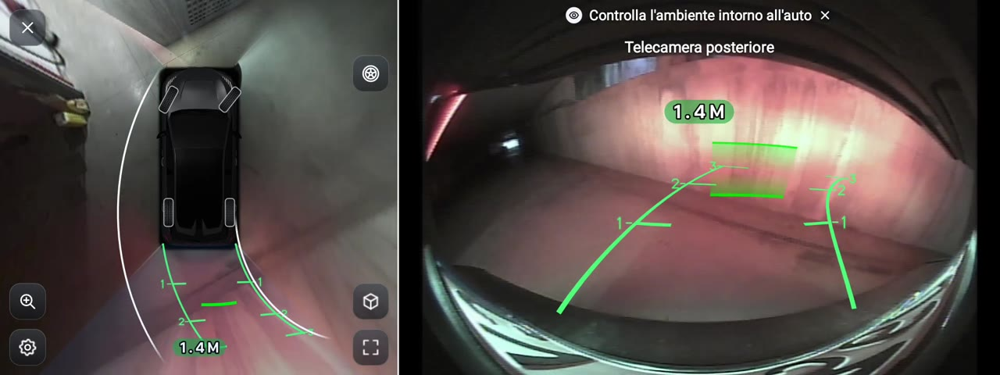

Vicino al paraurti compaiono le **barre dei sensori**, con la distanza dell'ostacolo in centimetri: verdi, poi gialle, poi rosse. Nell'immagine della telecamera posteriore le barre diventano **tende 3D**. Quando un ostacolo è vicino, la vista dall'alto **si ingrandisce da sola** in quel punto («Zoom automatico sull'ostacolo»).

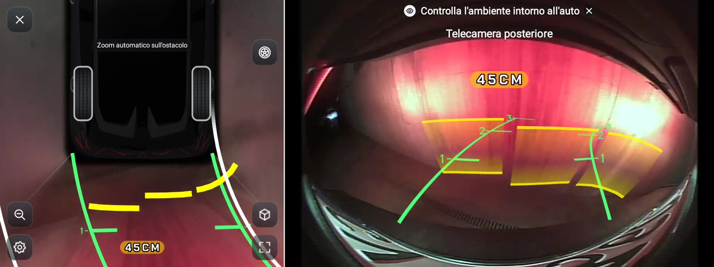

#### Tende 3D dei sensori di parcheggio
> [!TIP]
> Nella **telecamera posteriore** e nella **vista 3D** i sensori di parcheggio sono **tende 3D colorate** vicino al paraurti: **verdi** quando l'ostacolo è lontano, poi **gialle**, poi **rosse** quando è vicino. Senza bisogno di leggere i numeri, il colore e la posizione della tenda ti dicono subito **da che parte** è l'ostacolo e **quanto** manca.

### Cambiare vista
- **Telecamera:** tocca la zona intorno all'auto che vuoi vedere: davanti, dietro o uno dei lati.
- **Vista ampia:** il pulsante in basso a destra mostra più spazio intorno all'auto.
- **Lente:** il pulsante con la lente ingrandisce la zona che ti interessa.

### Vista 3D
Il pulsante con il **cubo** apre la vista 3D: l'auto si vede da fuori e la giri con un dito per guardarla da ogni lato. Con due dita ti avvicini; da molto vicino l'auto diventa trasparente e si vede cosa c'è sotto.

Il modello mostra luci, frecce e ruote che sterzano. Anche qui ci sono le **tende 3D dei sensori**: giri l'auto e le vedi da ogni lato.

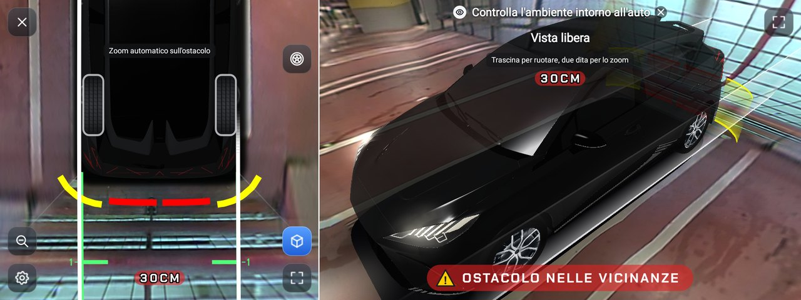

Nelle impostazioni scegli il colore dell'auto e i cerchi, e il modello cambia subito:

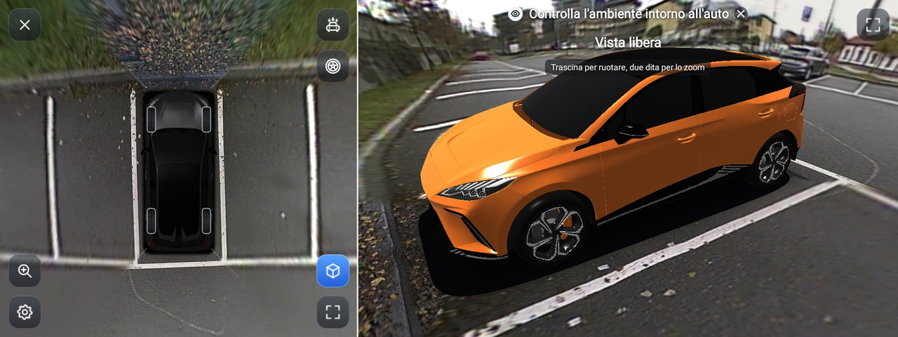

### Auto trasparente (prova)
Normalmente sotto l'auto c'è una zona nera: nessuna telecamera la vede. Con l'**auto trasparente** l'app ricorda l'asfalto che le telecamere hanno visto un attimo prima e, mentre l'auto ci passa sopra, lo mostra sotto di lei. Così l'auto diventa trasparente poco alla volta e vedi le strisce, i tombini o il bordo del marciapiede anche quando sono sotto la scocca.

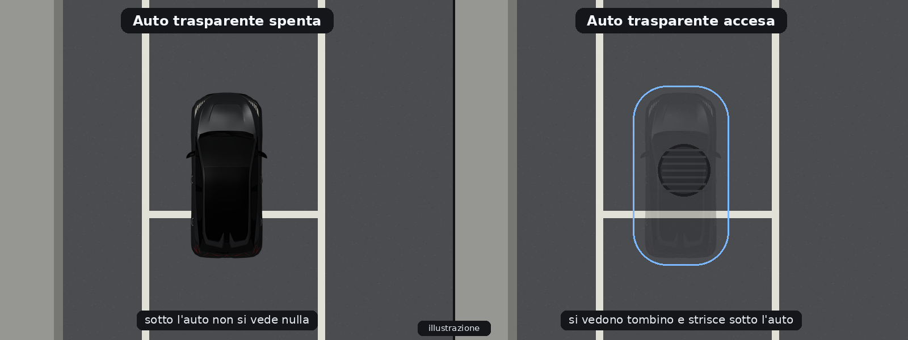

Funziona nella vista 360° e nella vista 3D. Si accende e si spegne con il pulsante sulla vista 360° (il terzo in alto a destra) oppure in Impostazioni › Vista 360° › Auto, dove la «i» la spiega con un'animazione. Va in pausa sopra i 7 km/h e riprende sotto i 5.

> [!CAUTION]
> È un **ricordo, non un'immagine dal vivo**: se qualcosa finisce sotto l'auto dopo (un sasso, un animale), **non si vede**. Non fidarti solo di questa vista.

### Vista ruote
Il pulsante con il **cerchione** apre la vista ruote: immagini raddrizzate con una **linea rossa** lungo il bordo dell'auto. Serve per avvicinarsi al marciapiede senza toccare gomme e cerchi. Ogni finestra si chiude con la sua X; un tocco la **ingrandisce**, un altro la riporta piccola.

La vista può aprirsi anche **da sola** a bassa velocità, quando giri il volante quasi a fine corsa: comodo nei parcheggi in parallelo.

**Parcheggio in parallelo:** mentre ti infili nello spazio, le finestre mostrano il marciapiede accanto a ogni ruota e la linea rossa dice quanto manca. Un tocco ingrandisce la ruota che ti interessa.

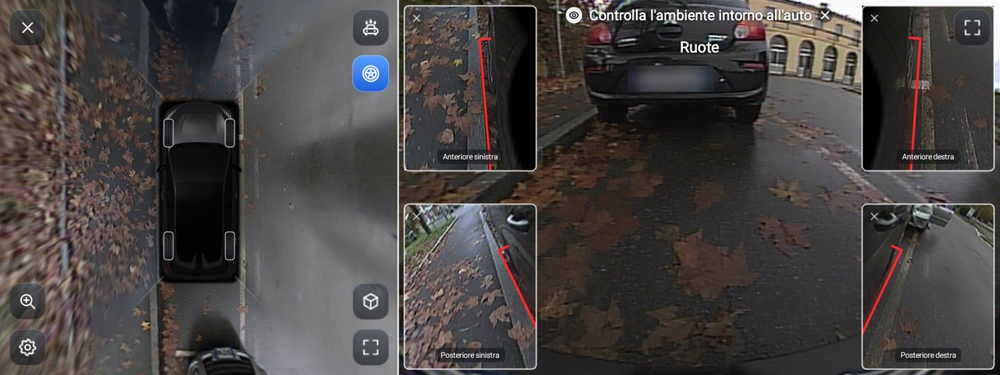

**Video (1 min 29 s):** il parcheggio in parallelo dall'inizio alla fine. Clicca l'immagine per vederlo su YouTube.

[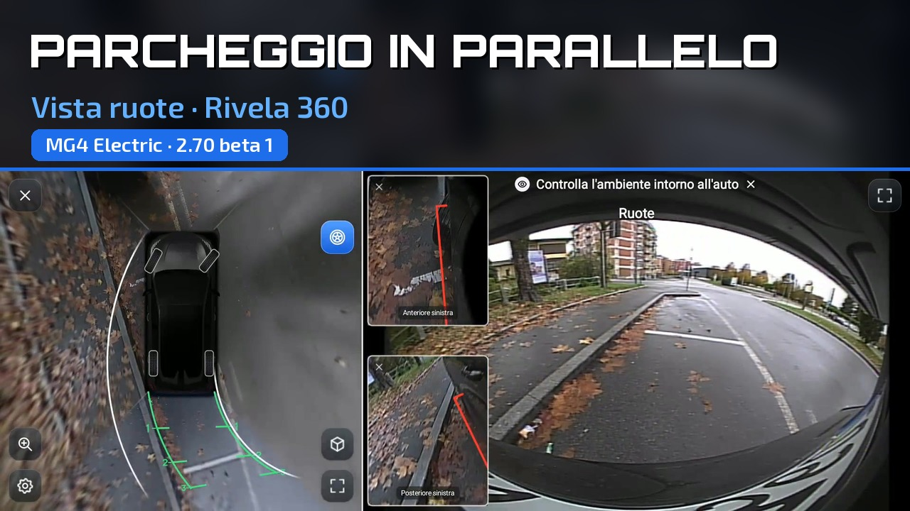](https://youtu.be/g0i7RoX5Mp8)

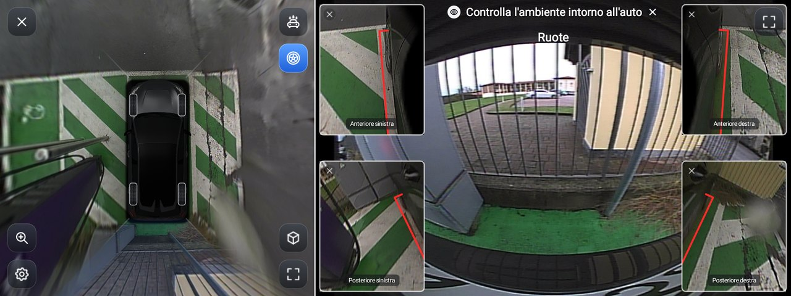

### Autolavaggio
Per entrare nel tunnel di lavaggio c'è la **modalità autolavaggio**: due fasce azzurre mostrano dove passeranno le ruote anteriori e aiutano a centrare le guide.

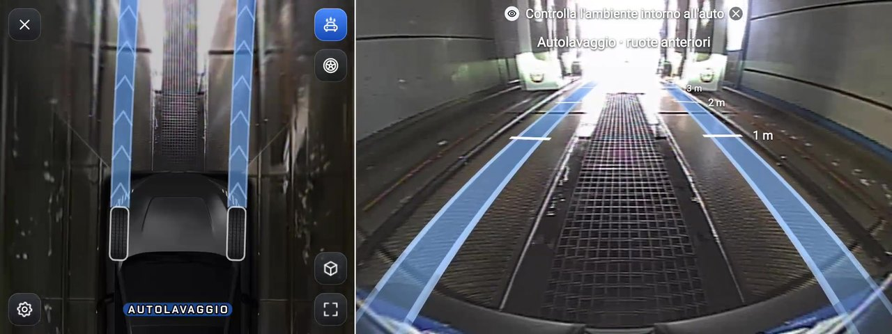

**Video (39 s):** l'ingresso nel tunnel di lavaggio con le fasce azzurre. Clicca l'immagine per vederlo su YouTube.

[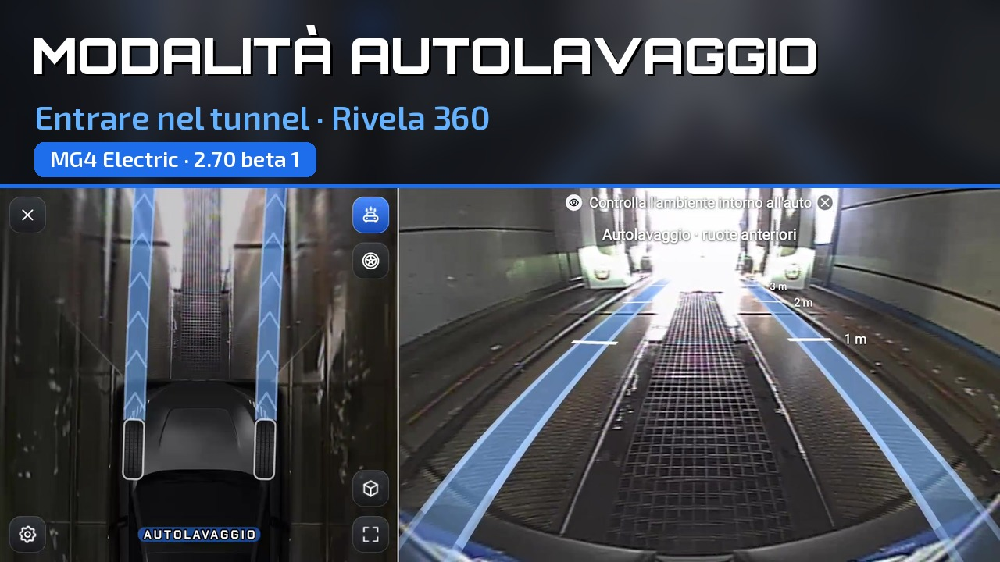](https://youtu.be/NuJO1H80DHk)

### In marcia avanti
Con la **freccia**, a bassa velocità, l'app mostra la telecamera di quel lato. Si può aprire anche a mano dall'icona, a qualsiasi velocità: con l'anteriore si vede bene davanti al muso.

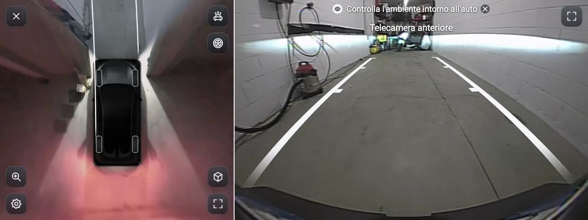

### Impostazioni
Si aprono dall'**ingranaggio** in basso a sinistra e sono divise in otto schede. Le cose più utili:

- **Apertura e chiusura:** cosa si apre con la retromarcia e le frecce, **Rivela 360 o la 360 di serie**. Da qui si torna alla 360 di serie in qualsiasi momento. Se apri l'app a mano, può restare aperta finché la chiudi tu.
- **Retromarcia** e **Marcia avanti:** linee guida, stile delle linee (Classico o Moderno) e zoom automatico sull'ostacolo, con la distanza a cui parte.
- **Vista 360°** e **Vista 3D:** colore dell'auto e del tetto, cerchi, luci e luminosità del modello 3D.
- **Prove e avanzate:** prove da fermi (retromarcia, sensori, traffico trasversale simulati) e la vista di ogni telecamera, **Originale** o **Panoramica**.
- **Aggiornamenti:** l'app si aggiorna via rete da questa pagina GitHub; qui si rileggono anche le novità di ogni versione.

Se hai un dubbio su una voce, tocca la **«i»** accanto: una breve animazione spiega cosa fa.

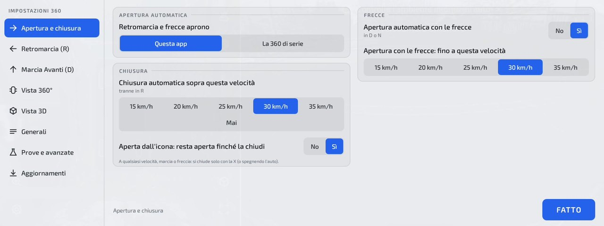
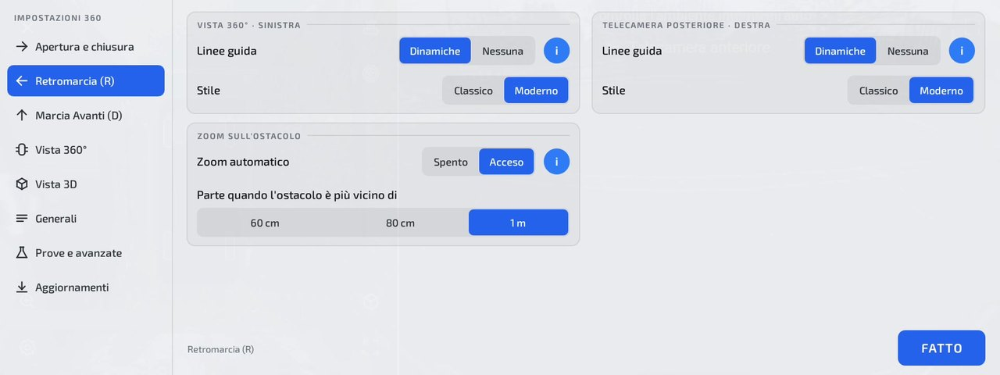
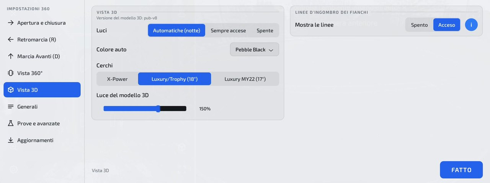
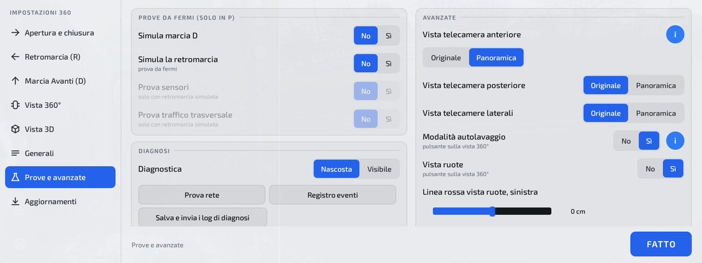

## Installare
La guida passo passo, con il ritorno alla 360 di serie, è in [**GUIDA.md**](GUIDA.md). In breve:
1. Scarica l'APK della **versione consigliata** dalla pagina [**Release**](https://github.com/andneg7/rivela360-mg4/releases/latest) (sezione *Assets*). Le beta più nuove sono nella cartella [`releases/`](releases/).
2. Copialo su una chiavetta USB, aprilo dal gestore file dell'auto e tocca *Installa*.
3. Alla prima apertura, da fermo in P, leggi e accetta le avvertenze. Fai una prima prova da fermo prima di usarla in manovra.

> [!NOTE]
> **Dopo l'accensione dell'auto aspetta che l'infotainment abbia finito di avviarsi.** Rivela 360 è disponibile solo a avvio completato. Nel frattempo, in retromarcia, c'è la retrocamera rapida di serie (fast RVC), che è indipendente da Android e funziona anche durante l'avvio.

## Tornare alla 360 di serie
Prima di disinstallare l'app o di fare un aggiornamento firmware MG: *Impostazioni › Retromarcia e frecce aprono › La 360 di serie*. Tutti i dettagli sono nella [guida](GUIDA.md#tornare-alla-360-di-serie).

## Come funziona la vista 3D
La proiezione delle telecamere sulla «ciotola», le distorsioni e i limiti delle 4 camere sono spiegati in [**PROIEZIONE-3D.md**](PROIEZIONE-3D.md).

## Note tecniche
Come sono fatte le telecamere, il firmware, la 360 di serie, la retrocamera rapida e i dati dell'auto, con quello che abbiamo verificato in auto: [**NOTE-TECNICHE.md**](NOTE-TECNICHE.md).

## Beta testing
Vuoi aiutare a provarla? Le istruzioni, con l'elenco delle prove e il modulo per il risultato, sono in [**BETATEST.md**](BETATEST.md).

## Segnalare un problema
Impostazioni › *Prove e avanzate* › Diagnosi › *Salva e invia i log di diagnosi*: il file viene salvato in `Download/MG4-360-log`. Apri una [segnalazione (Issue) su GitHub](https://github.com/andneg7/rivela360-mg4/issues/new) e allega il file, indicando modello e anno dell'auto, firmware, versione dell'app e cosa stavi facendo. Le Issue sono pubbliche: niente dati personali.

## Aggiornamenti
L'app controlla gli aggiornamenti da questa repository (Impostazioni › Aggiornamenti). L'elenco delle versioni è in [`releases/`](releases/). I canali sono due: **Stabile** (predefinito) e **Beta**, che riceve per prima le versioni di prova. Dopo ogni aggiornamento l'app mostra una volta la finestra **Novità** con cosa è cambiato (si rilegge in Impostazioni › Aggiornamenti).

## Freeware e donazioni
**Rivela 360 è freeware**: si scarica e si usa gratis, senza pubblicità, senza funzioni a pagamento e senza registrazione. Non è open source (il codice non è pubblicato).
Se ti è utile e vuoi sostenere il lavoro, puoi **offrirmi un caffè** su Ko-fi (o con PayPal): è una donazione libera e facoltativa. Non dà diritto a nulla in più: nessuna funzione extra, nessun supporto garantito, nessuna priorità.

 

## Licenza e crediti
Testo completo delle condizioni: [**LICENSE**](LICENSE).

- **Rivela 360** è gratuita per uso personale e non commerciale. Il codice non è pubblicato. Non è consentito venderla né distribuirla a pagamento.
- **Modello 3D dell'auto**: «[2025 MG MG4 (GLB)(mgmotor.com.mx)](https://sketchfab.com/3d-models/2025-mg-mg4-glbmgmotorcommx-ee2e3b0e1a7b481cb2c08e6fc6d2ed9e)» di **MattDoesBlender** (Sketchfab), licenza [**CC BY-NC-SA 4.0**](https://creativecommons.org/licenses/by-nc-sa/4.0/). I file `car3d-pub-*.bin` sono versioni **modificate**: semplificate (da circa 1,1 milioni a circa 430.000–550.000 triangoli), divise in gruppi e riordinate per la scheda grafica, con la carrozzeria ricolorata, gli interni tolti e i loghi del costruttore e le targhe rimossi. I cerchi X-Power sono quelli del modello, con le pinze dei freni colorate; per Luxury/Trophy 18″ e Luxury MY22 17″ il cerchio è un'immagine applicata sul disco, con il coprimozzo senza logo e gomme in proporzione. Anche le immagini dell'auto vista dall'alto usate dall'app sono ricavate da questo modello. Sono distribuite con la stessa licenza: solo uso non commerciale, con questa attribuzione.
- **Vista ruote**: idea da [MG4-360-Camera-App](https://github.com/jamakr4/MG4-360-Camera-App) di **jamakr4**, con il suo permesso. Il codice è nostro. Anche la collaborazione tra le due app sulle telecamere (Release/Resume) è nata con lui.
- **Caratteri**: Exo 2, Chakra Petch e Orbitron, con licenza SIL Open Font License 1.1.
- L'app non contiene né usa immagini o testi dell'app di serie: auto vista dall'alto, icone e avvisi sono disegnati da noi. Legge dall'auto solo i dati che servono a funzionare (telecamere, marcia, sterzo, sensori, calibrazione).
- MG, MG4 e SAIC sono marchi dei rispettivi proprietari, citati solo per indicare la compatibilità.

## Uso dell'intelligenza artificiale
Parti del codice, della documentazione e della grafica di Rivela 360 sono state sviluppate con l'aiuto dell'intelligenza artificiale (**Claude** di Anthropic). Le scelte, le prove in auto e la responsabilità del progetto restano dello sviluppatore.
