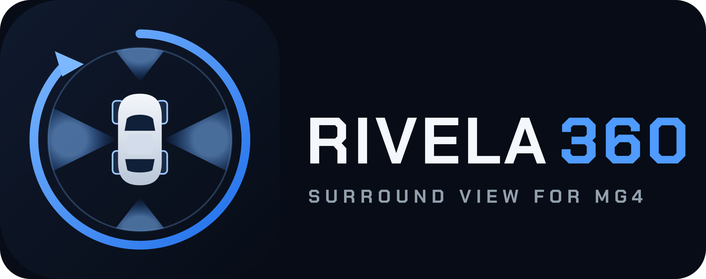
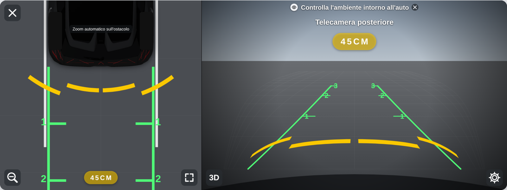
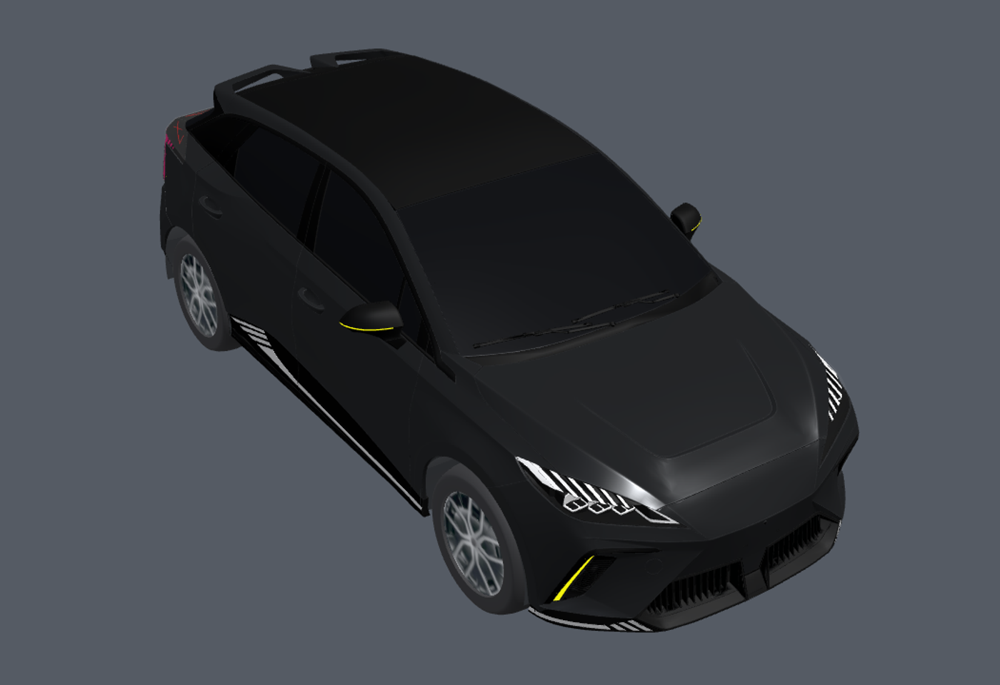
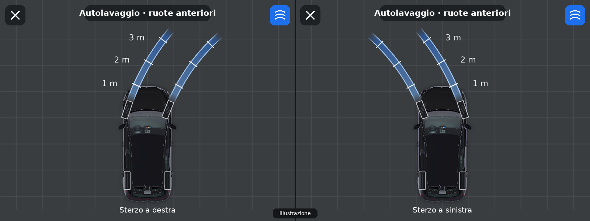
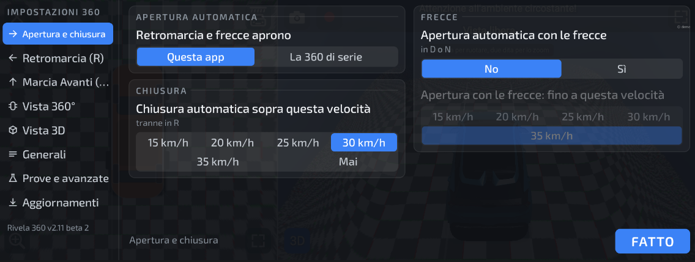
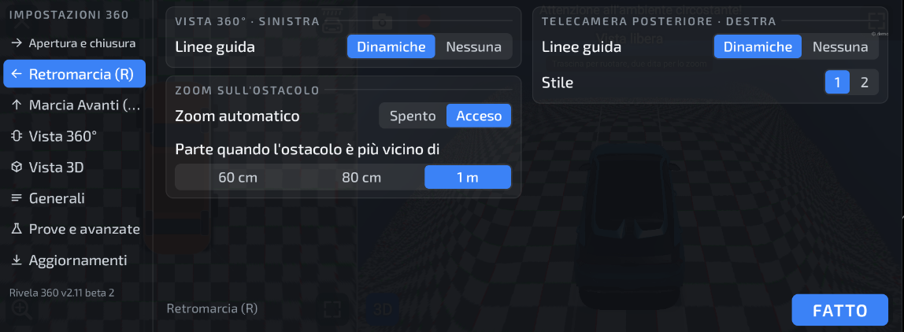
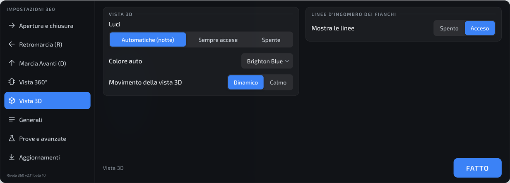

🇮🇹 Italiano | [🇬🇧 English](README.en.md)

# Rivela 360

 Freeware: se ti è utile, puoi sostenere il progetto con una donazione libera e facoltativa.

**Vista 360° alternativa per MG4 Electric.** Un progetto indipendente e gratuito che sostituisce l'interfaccia della telecamera 360° di serie con una vista più chiara, con il modello 3D dell'auto e molte funzioni in più.

> [!WARNING]
> ## 🧪 VERSIONI BETA SPERIMENTALI: USARE CON CAUTELA
> **Tutte le versioni di Rivela 360 sono, per ora, beta sperimentali.** È un progetto amatoriale, provato finora su una sola auto. Possono contenere errori, comportarsi in modo imprevisto o smettere di funzionare dopo un aggiornamento. **Usale con cautela**: non affidarti mai a questa app come unico modo per vedere intorno all'auto. La 360° di serie si può ripristinare in qualsiasi momento dalle impostazioni dell'app.

> [!CAUTION]
> ## ⚠️ AUSILIO ALLA GUIDA: NON SOSTITUISCE LA TUA ATTENZIONE
> - **Rivela 360 è solo un aiuto.** Immagini, linee guida, distanze, colori, barre dei sensori e avvisi possono essere **imprecisi, in ritardo, assenti o sbagliati**.
> - **Il guidatore è sempre l'unico responsabile della manovra.** Guarda **sempre** anche gli specchietti e **direttamente fuori** dal finestrino, e rispetta il Codice della strada.
> - **Non fidarti solo dello schermo** per distanze, ostacoli, persone, animali o bambini vicino all'auto.
> - **Sostituisce un'applicazione di serie dell'auto** e usa permessi di sistema: può causare malfunzionamenti, anche della telecamera originale, e far decadere la garanzia. **Installazione e uso sono a tuo esclusivo rischio.**
> - **Provala sempre da fermo**, in P, in un posto sicuro, prima di usarla in manovra.
> - Prima di installarla leggi le [**Avvertenze e responsabilità**](DISCLAIMER.md): installandola le accetti.

> **Progetto personale, non ufficiale e non collegato a MG Motor né a SAIC.**
>
> 🔬 **Versione di prova.** È stata provata su una sola configurazione: **MG4 Electric Luxury MY23, unità FICM, firmware SWI68 R67, Android 9**. Su altre versioni non so come si comporta.
>
> | Firmware | Stato |
> |---|---|
> | **SWI68 R67** | ✅ **Testato** |
> | **SWI133** | ⚠️ **Non testato.** L'analisi del firmware non mostra differenze rilevanti (stessa base Android 9, stessa app 360 di serie, stessa firma di sistema), ma solo una prova sull'auto lo conferma |
> | Altri | ❓ Sconosciuto |

## Cosa fa
- **Vista 360°** costruita dalle 4 telecamere, accanto alla vista di una telecamera alla volta o alla **vista 3D** con il modello dell'auto.
- **Linee dinamiche** che seguono lo sterzo, **linee d'ingombro dei fianchi** con l'arco completo da fermi e **barre dei sensori** anche in 3D.
- **Sensori di parcheggio** con la distanza in cm e zoom automatico sull'ostacolo, e avviso di **traffico trasversale** in retromarcia.
- **Modalità autolavaggio**: fasce azzurre delle ruote anteriori per entrare nel binario dei tunnel di lavaggio, anche in 3D con l'auto semitrasparente.
- **Apertura automatica** in retromarcia e con le frecce, con velocità di apertura e chiusura regolabili.
- **Rete di sicurezza**: se in retromarcia l'app non mostra l'immagine entro 2,5 secondi, si apre la 360 di serie.
- **Foto, video e registrazione automatica delle manovre**, anche su chiavetta USB.
- Lingue: inglese, italiano, tedesco, francese e spagnolo.

## Come si presenta
> Le immagini della retromarcia e della vista 3D sono **mockup** (schermata simulata e render del modello 3D); quelle delle impostazioni sono schermate vere della versione demo. Nessuna è una foto dell'auto. Nell'auto l'aspetto può differire in qualche dettaglio.

**Retromarcia:** vista 360° a sinistra, telecamera posteriore a destra, con linee guida, barre dei sensori e distanza in cm.

**Vista 3D** con il modello dell'auto:

**Modalità autolavaggio** (telecamera anteriore): le due fasce che le ruote percorreranno, con le tacche a 1, 2 e 3 m. *Illustrazione, non è una schermata vera.*

**Impostazioni** (schermate vere della versione demo, pensate per il tocco):

## Installare
La guida passo passo, con il ritorno alla 360 di serie, è in [**GUIDA.md**](GUIDA.md). In breve:
1. Scarica l'ultimo APK dalla cartella [`releases/`](releases/).
2. Copialo su una chiavetta USB, aprilo dal gestore file dell'auto e tocca *Installa*.
3. Alla prima apertura, da fermo in P, leggi e accetta le avvertenze. **Provala sempre da fermo prima di usarla in manovra: è solo un ausilio, la responsabilità della manovra resta tua.**

## Tornare alla 360 di serie
Prima di disinstallare l'app o di fare un aggiornamento firmware MG: *Impostazioni › Retromarcia e frecce aprono › La 360 di serie*. Tutti i dettagli sono nella [guida](GUIDA.md#tornare-alla-360-di-serie).

## Come funziona la vista 3D
La proiezione delle telecamere sulla «ciotola», le distorsioni e i limiti delle 4 camere sono spiegati in [**PROIEZIONE-3D.md**](PROIEZIONE-3D.md).

## Beta testing
Vuoi aiutare a provarla? Le istruzioni, con l'elenco delle prove e il modulo per il risultato, sono in [**BETATEST.md**](BETATEST.md).

## Segnalare un problema
Impostazioni › *Prove e avanzate* › Diagnosi › *Salva e invia i log di diagnosi*: il file viene salvato in `Download/MG4-360-log`. Apri una [segnalazione (Issue) su GitHub](https://github.com/andneg7/rivela360-mg4/issues/new) e allega il file, indicando modello e anno dell'auto, firmware, versione dell'app e cosa stavi facendo. Le Issue sono pubbliche: niente dati personali.

## Aggiornamenti
L'app controlla gli aggiornamenti da questa repository (Impostazioni › Aggiornamenti). L'elenco delle versioni è in [`releases/`](releases/). I canali sono due: **Stabile** (predefinito) e **Beta**, che riceve per prima le versioni di prova.

## Freeware e donazioni
**Rivela 360 è freeware**: si scarica e si usa gratis, senza pubblicità, senza funzioni a pagamento e senza registrazione. Non è open source (il codice non è pubblicato).
Se ti è utile e vuoi sostenere il lavoro, puoi fare una **donazione libera e facoltativa** con PayPal. Non dà diritto a nulla in più: nessuna funzione extra, nessun supporto garantito, nessuna priorità.

## Licenza e crediti
Testo completo delle condizioni: [**LICENSE**](LICENSE).

- **Rivela 360** è gratuita per uso personale e non commerciale. Il codice non è pubblicato. Non è consentito venderla né distribuirla a pagamento.
- **Modello 3D dell'auto**: «[2025 MG MG4 (GLB)(mgmotor.com.mx)](https://sketchfab.com/3d-models/2025-mg-mg4-glbmgmotorcommx-ee2e3b0e1a7b481cb2c08e6fc6d2ed9e)» di **MattDoesBlender** (Sketchfab), licenza [**CC BY-NC-SA 4.0**](https://creativecommons.org/licenses/by-nc-sa/4.0/). Il file `car3d-pub-v4.bin` è una versione **modificata**: semplificata (da circa 1,1 milioni a circa 550.000 triangoli), divisa in gruppi e riordinata per la scheda grafica, con la carrozzeria ricolorata di nero, interni e pinze dei freni tolti, i cerchi sostituiti da un disegno e i loghi del costruttore e le targhe rimossi. È distribuita con la stessa licenza: solo uso non commerciale, con questa attribuzione.
- **Caratteri**: Exo 2, Chakra Petch e Orbitron, con licenza SIL Open Font License 1.1.
- Le immagini e i dati originali dell'auto non sono inclusi: l'app li legge dall'auto mentre funziona.
- MG, MG4 e SAIC sono marchi dei rispettivi proprietari, citati solo per indicare la compatibilità.
